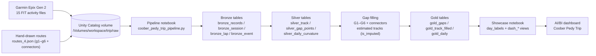

# Coober Pedy Trip

An end-to-end data project built around a **motorcycle trip** through the Flinders Ranges and outback South Australia, finishing in Coober Pedy (October 2026).

## What's in this repo

* `fit_files/fit/` — 15 raw Garmin activity recordings (`.fit`) captured on a Garmin Epix Gen 2
* `fit_files/routes*.json` — hand-drawn route waypoints (`routes_4.json` is the latest, routes g1–g6 plus connectors) used to estimate GPS gaps where recording was off
* `fit_files/breakaways_loop_check.geojson` — verification output for the Coober Pedy Breakaways loop day

## What was done

1. **Ingestion** — raw FIT files and hand-drawn routes were uploaded to a Unity Catalog volume (`/Volumes/workspace/trip/raw`).
2. **Pipeline** — a Databricks notebook (`coober_pedy_trip_pipeline.py`) parses the FIT files and builds a medallion architecture of Delta tables in `workspace.trip`: bronze (raw records, sessions, laps, events) → silver (tracks, gap points, daily curvature) → gold (gaps, filled track, daily summaries).
3. **Gap filling** — six unrecorded stretches (G1–G6) plus connectors were filled with estimated tracks from the hand-drawn waypoints; imputed points are labelled `is_imputed` with a confidence level and basis.
4. **Dashboard** — an AI/BI dashboard ("Coober Pedy Trip") presents the trip: route map (recorded vs estimated), daily KM, trip records, and speed bands.

## Architecture

## Trip stats

* **Total distance:** 4,656 km — 3,807 km recorded, 848 km estimated (82% recorded)
* **Riding days:** 14
* **Longest day:** 835 km
* **Moving time:** ~68.4 hours

---
Dashboard colour convention: recorded = blue, estimated = amber.

---
This README was created with the assistance of Genie, Databricks' built-in AI assistant.
